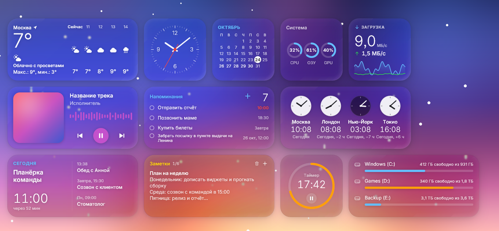
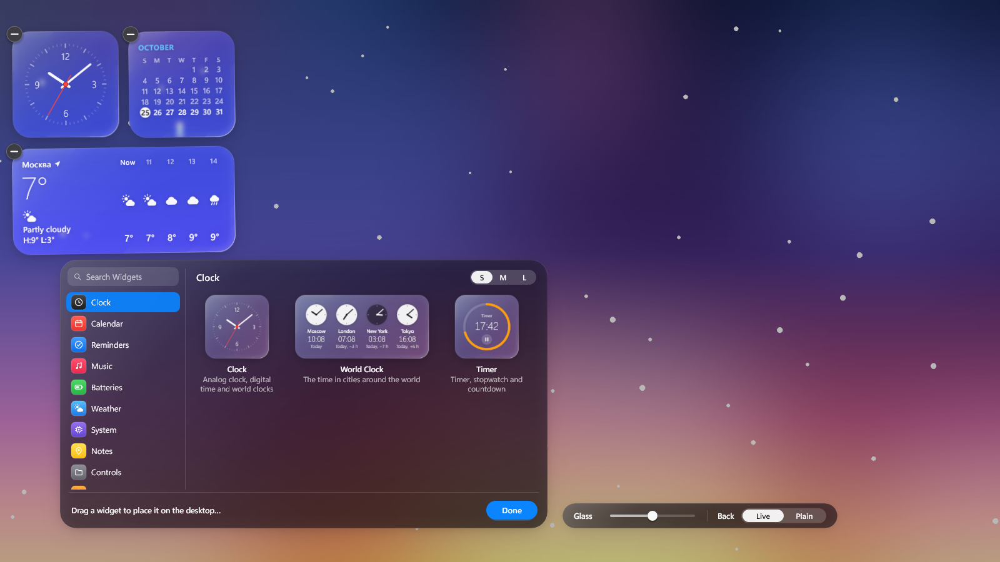
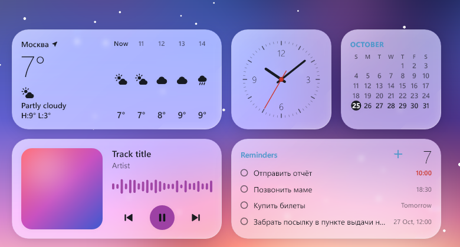
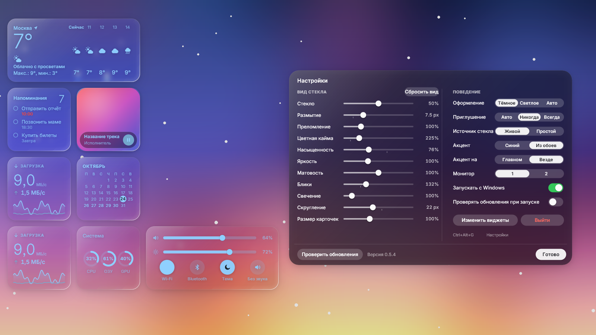

# Glass Widgets

[](../../releases/latest)
[](LICENSE)




Project page: <https://chvdbhcx-del.github.io/glass-widgets/> (source in `docs/index.html`).

Native desktop widgets for Windows 10/11 with a Liquid-Glass look: translucent, refracting cards that float over your wallpaper
(an animated one too). No WebView, no Electron: one transparent layered window drawn with Direct2D on the GPU, a 0.7 MB installer
and roughly 100 MB of RAM and under 10 % of one CPU core while the wallpaper moves.

*По-русски: нативные виджеты рабочего стола для Windows 10/11 в стиле «жидкого стекла»: полупрозрачные карточки с преломлением
поверх обоев (в том числе живых). Без WebView и Electron, на Direct2D, установщик меньше 1 МБ.*

## Highlights

- **Real glass**: each card refracts and blurs the wallpaper behind it, with a chromatic fringe, a specular highlight that follows
  the light and a soft materialise animation. Cards that touch merge into one blob.
- **Dark or light glass** (`dark` by default) and crisp, smooth Inter typography (bundled, SIL OFL; Nunito is available with `MSW_FONT=nunito`).
- **Live wallpapers work**: the glass reads the wallpaper window itself, so it follows videos and animated wallpapers.
- **Visible to screenshots and screen recorders**: the layer never captures itself.
- **Light**: about 100 MB of RAM and under 10 % of one core with an animated wallpaper.
- **Private**: the network is used only by the widgets that need it (weather, rates, crypto, quote, site icons); no telemetry.

| Dark glass, edit mode and the widget gallery (`Ctrl+Alt+W`) | Light glass |
| --- | --- |
|  |  |

## Widgets

Clock, calendar, reminders, music (now playing), batteries, weather, world clock, system monitor, disks, network, processes, notes,
timer, shortcuts (apps, folders and sites with their own icons), clipboard history, photos, currency rates, crypto prices, quote of the day, next event (from a local `.ics` file or a calendar subscription link), countdown to a date and quick
controls. Cards come in S / M / L sizes, snap to a grid, can be dragged, and merge into one blob when they touch.

## Install

Download `GlassWidgets_<version>_x64-setup.exe` from the [releases page](../../releases) and run it. It installs per user (no
administrator rights) and can start Glass Widgets with Windows. The installer is not code-signed, so SmartScreen may ask you to confirm.

### Install with winget (once the package is accepted)

Not available yet: the package `chvdbhcx-del.GlassWidgets` has not been submitted to [winget-pkgs](https://github.com/microsoft/winget-pkgs), so
`winget install` will not find it today. `pwsh tools\winget-manifest.ps1` prepares the three manifest files for the latest release (URL and
SHA256 are read from the GitHub release, output goes to `dist\winget\<version>\`); submitting them is a manual pull request. Once it is accepted,
this will work:

```
winget install chvdbhcx-del.GlassWidgets
```

| Keys | Action |
| --- | --- |
| `Ctrl+Alt+G` | settings panel |
| `Ctrl+Alt+W` | edit mode: gallery to add widgets, resize, remove |
| `Ctrl+Alt+Q` | quit (if another program already owns this combination, close the process from Task Manager) |

The layer sits above the wallpaper and under your windows, like desktop widgets should. It is visible to screenshots and screen
recorders: the glass reads the wallpaper window itself (Windows Graphics Capture), never the screen, so it does not see itself.

## Tray icon and settings panel

Glass Widgets lives in the notification area (Windows 11 may keep it under the `^` chevron: drag it out to pin it). Left click opens
the settings panel; right click shows a menu: **Settings**, **Edit Widgets**, **Hide / Show Widgets**, **Layouts**, **Start with Windows**, **Quit**.

**Layouts** keeps named desks (cards and glass look): pick one to switch (the desk you leave is saved back into the layout that was active, so nothing is lost), *Save current layout as...* names the current desk, *Delete current layout* forgets the active name (the desk stays).



The panel has sliders that change the look of the widgets live: glass amount, blur, refraction, chromatic fringe, saturation, brightness,
frosting, highlights, glow, corner roundness and card size. It also switches dark / light / auto glass, dimming, live or plain glass,
autostart and the accent colour (blue, or taken from the wallpaper) of card titles and of the panels' own buttons and focus rings. "Reset look" brings everything back to the defaults. Drag the panel (or the gallery) by an empty spot: it remembers
where you left it. The sliders also work from the keyboard (`Up` / `Down` / `Tab` pick one, `Left` / `Right` change it by 1 %, with
`Shift` by 10 %, `Home` / `End` jump, `Backspace` resets it) and with the mouse wheel.

**Updates.** "Check for updates" asks GitHub once for the latest release. If a newer version exists you get **Update now** and
**Release page** (opens the page in your browser). "Update now" downloads the installer of that release (HTTPS, from github.com only,
at most 20 MB) into `%TEMP%\GlassWidgets-update`, checks its SHA-256 against the checksum GitHub publishes for the file, and only if it matches runs it
silently (`/S`): the installer closes Glass Widgets, replaces it and starts the new version again. If the checksum is missing or does not match,
the file is deleted and nothing is run. Nothing is downloaded or installed unless you press the button. "Check for updates on start"
(off by default) only does the check, silently, and shows a small notice if a newer version exists.

## Settings file

Everything lives in `%APPDATA%\macshell\config.json` (written by the edit mode; you rarely need to touch it):

| Key | Values |
| --- | --- |
| `widgetsLayout` | list of cards: `type`, `size` (`s` `m` `l`), `col`, `row`, `cfg` (per-widget settings) |
| `widgetsMonitor` | the monitor the desk lives on: `primary` (default), `cursor` (the one under the mouse at start), a number (1 = primary, then left to right) or a device name such as `\.\DISPLAY2` (what the settings panel / tray menu store). A monitor that is gone falls back to the primary one and the desk returns when it is plugged in again |
| `monitorLayouts` | the cards of every non-primary monitor: `{ "\.\DISPLAY2": [ ...like widgetsLayout... ] }` (`widgetsLayout` stays the primary monitor's layout; `monitorProfiles` holds the checked profile per monitor; look, panels and the rest are shared) |
| `widgetsGlassMode` | anything but `plain` = live wallpaper behind the glass; `plain` = no capture, cheapest |
| `widgetsAppearance` | `dark` (default), `light` or `auto` (follows the brightness under each card) |
| `widgetsDim` | `auto` (default), `never`, `always` |
| `widgetsGlass` | glass amount, `0`..`1` (default `0.5`) |
| `widgetsLook` | the other sliders of the settings panel (only the changed ones) |
| `widgetsPanels` | where the gallery / settings panel were dragged: `{"gallery":[dx,dy],"settings":[dx,dy]}` (only non-zero ones) |
| `captureFps` | wallpaper capture rate: `auto` (default: up to 15 fps, backing off to 2 fps while the wallpaper under the cards is still, back to full rate on the first change) or a number `1`..`30` for a fixed rate |
| `checkUpdates` | `true` = one silent update check at start (default `false`) |
| `accentMode` | `blue` (default) or `wallpaper` (the dominant hue of the desktop wallpaper, re-read when the wallpaper changes) |
| `profiles`, `activeProfile` | saved layouts: `{ name: { items: [...], look: {...} } }` and the checked one (the Layouts submenu of the tray) |

Network is used only by the widgets that need it (weather, rates, crypto, quote, site icons of shortcut tiles) and by the update check, which runs only
when you press "Check for updates" or turn on `checkUpdates` (the installer is downloaded only after you press "Update now"); nothing else phones home.
Network is used only by the widgets that need it (weather, rates, crypto, quote, site icons of shortcut tiles, the calendar link of Next event) and by the update check, which runs only
when you press "Check for updates" or turn on `checkUpdates`; nothing else phones home.
Next event: the card's `ics` setting is a path to an `.ics` file or a subscription link (`https://...` or `webcal://...`, e.g. the "secret address in iCal
format" of a Google / iCloud / Outlook calendar). A link is fetched only while the card is on the desktop (never in the gallery preview), at most every 30 min,
at most 2 MB, 15 s timeout; the last good copy is kept in `%APPDATA%\macshell\cache
extevent-<hash>.ics`, so the card also works offline. Only `https` is
accepted (`webcal` is rewritten to it); user:password@ forms, `localhost`, `*.local` and private / loopback / link-local addresses are refused. The link is never
written to any log (only its host), because it usually contains a secret token.
Advanced knobs are environment variables, for example `MSW_CAPTURE=gdi|dxgi` (older capture paths) and `MSW_TEXT_GAMMA`.

## Build from source

Needs Rust (stable, MSVC toolchain) on Windows.

```
cargo build --release          # target\release\mswidgets.exe
pwsh tools\release.ps1 -NoPublish   # also builds the installer into dist\ (needs NSIS: makensis.exe)
```

Developer guide, widget API and the headless render/test tools are in [NATIVE.md](NATIVE.md). A widget is one file in
`src/widgets/`. `mswidgets --calib` fits the glass against reference screenshots; those are not included in the repository.

## License

MIT, see [LICENSE](LICENSE). This is an independent clean-room implementation and is not affiliated with or endorsed by Apple.
