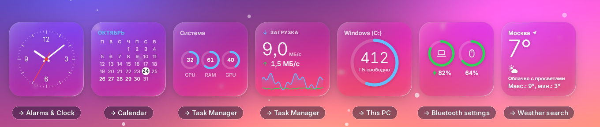
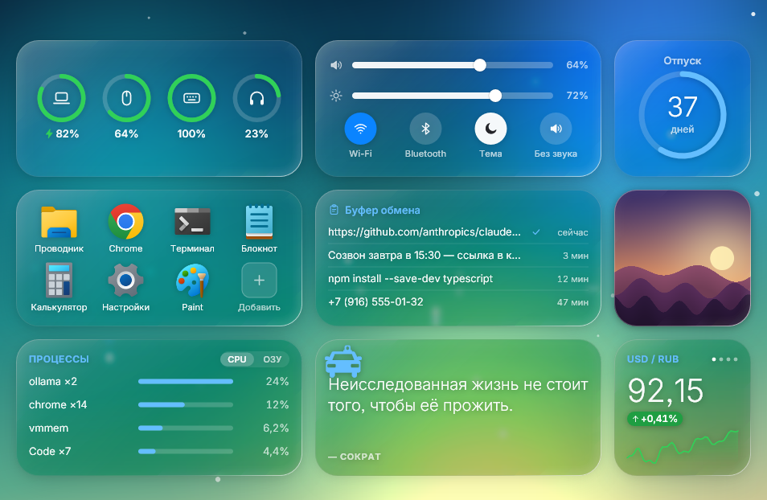
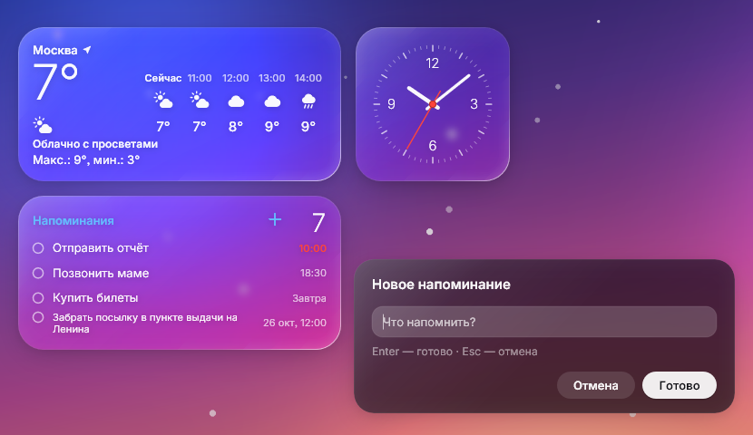

<div align="center">

# Glass Widgets

**Liquid-Glass desktop widgets for Windows 10/11: translucent cards that refract your wallpaper, drawn natively with Direct2D.**

[](../../releases/latest)
[](LICENSE)


[Project page](https://chvdbhcx-del.github.io/glass-widgets/) · [Download](../../releases/latest) · [Developer guide](NATIVE.md) · [Changelog](CHANGELOG.md)

</div>

*По-русски: нативные виджеты рабочего стола для Windows 10/11 в стиле «жидкого стекла»: полупрозрачные карточки с преломлением
поверх обоев (в том числе живых). Без WebView и Electron, на Direct2D, установщик около 1,3 МБ.*

No WebView, no Electron: one transparent layered window, drawn on the GPU. The cards float above the wallpaper (an animated one too) and
under your windows, like desktop widgets should.

## What's new in 0.5.12

**Cards now open the matching Windows tool when you click them.**



Task Manager (System, Network, Processes), This PC (Disks), Alarms & Clock (Clock), the calendar app or Google Calendar (Calendar, Next event),
a weather search for the shown city (Weather: the city name itself still changes the city), the Bluetooth settings (Batteries), and in Quick Actions the
Sound / Display settings from the glyph next to each slider. Nothing opens in edit mode, while a card is dragged, or in previews.
See the [changelog](CHANGELOG.md) for everything else (0.5.11: idle CPU with a video wallpaper fell from about 50 % to about 8 % of one core).

## Highlights

- **Real glass.** Each card refracts and blurs the wallpaper behind it, with a chromatic fringe, a specular highlight that follows the light and a
  soft materialise animation. Cards that touch merge into one liquid blob.
- **Dark, light or automatic glass**, crisp Medeo Sans typography (bundled, SIL OFL), a hover light that follows the pointer.
- **Live wallpapers work.** The glass reads the wallpaper window itself (Windows Graphics Capture), so it follows videos and animated wallpapers.
- **Visible to screenshots and screen recorders**: the layer never captures itself.
- **Light on resources.** About 8-9 % of one CPU core and about 145 MB of RAM with a video wallpaper (measured on 0.5.11 / 0.5.12). The desk sleeps by itself
  while nobody can see it: session locked, monitors off, PC suspended, or every card fully covered by other windows.
- **22 widgets** in S / M / L sizes on a snap grid, drag and drop, named layouts, several monitors.
- **Private.** The network is used only by the widgets that need it; no telemetry (details [below](#privacy)).

| Edit mode and the widget gallery (`Ctrl+Alt+W`) | Light glass |
| --- | --- |
|  |  |

## Widgets



| Widget | Shows | Click |
| --- | --- | --- |
| **Clock** | analog face; M adds the digital time and date; L adds world clocks | Alarms & Clock |
| **World Clock** | city columns with mini analog clocks (light by day, dark by night) | city removes it, `+` adds one |
| **Calendar** | month grid with today marked; L pages months with the chevrons | calendar app (Google Calendar if none is installed) |
| **Next event** | upcoming events from a local `.ics` file or a calendar subscription link | calendar; `Ctrl`+click changes the source |
| **Reminders** | tasks with due times | tick off, add new |
| **Countdown** | days left to a date, with a progress ring | set date and title |
| **Timer** | timer, stopwatch and Pomodoro | start / pause / reset |
| **Music** | now playing from the Windows media controls, cover, prev / play / next | media buttons |
| **Weather** | current weather, hourly and 5-day forecast (Open-Meteo) | city name: change city; the rest: weather search |
| **Batteries** | this PC and Bluetooth devices as rings | Bluetooth settings |
| **System** | CPU, RAM and GPU (NVIDIA, through NVML) with graphs | Task Manager |
| **Disks** | used / free space of your drives | This PC |
| **Network** | download / upload speed with sparklines | Task Manager |
| **Processes** | the busiest programs by CPU or RAM | header: CPU / RAM; the rest: Task Manager |
| **Notes** | sticky notes (stored locally in `notes.json`) | select, edit, add |
| **Shortcuts** | launcher tiles for apps, folders and sites (sites with their own icons) | launch; `+` adds, right click removes |
| **Clipboard** | history of copied text | row puts it back, right click forgets it |
| **Photos** | slideshow of one folder | next photo, right click picks the folder |
| **Rates** | currency pairs with sparklines | cycle pairs / edit the list |
| **Crypto** | coin prices and 24 h change | cycle coins / edit the list |
| **Quote of the Day** | a short saying from a built-in list (works offline) | next quote |
| **Quick Actions** | volume and brightness sliders, Wi-Fi / Bluetooth / theme / mute, lock, sleep, restart, shut down (second click to confirm) | glyph left of the sliders opens Sound / Display settings |
| **Agents** | Claude Code / Codex sessions from the Pill island hooks: project, working or waiting, count (reads `%APPDATA%\pill\agents`, read-only) | - |
| **Tasks** | a plain checklist: open count and next task (S), up to 5 tasks with checkboxes (M); stored locally in `tasks.json` | `+` adds, click ticks, right click deletes |
| **Ping** | round-trip time to 1.1.1.1, your gateway and hosts you add, with loss and a 60-sample sparkline (ICMP through the Windows API; a live card on the desk is the opt-in, previews send nothing) | `+` adds a host, right click removes one |
| **Disk health** | Windows health verdict of each physical disk (worst first) with temperature, wear and power-on hours where Windows reports them (often "n/a" without administrator rights) | - |
| **Downloads** | browser files still being written to your Downloads folder (`.crdownload`, `.part`, `.download`, growing `.tmp`) with size and speed; the folder is only listed, no file is opened | - |

Cards snap to a grid, can be dragged, resized from the right-click menu and merge when they touch.



*Text prompts and context menus are drawn by the app itself in the same glass look.*

## Install

Download `GlassWidgets_<version>_x64-setup.exe` from the [releases page](../../releases/latest) and run it. It installs per user (no
administrator rights) and can start Glass Widgets with Windows. The installer is not code-signed, so SmartScreen may ask you to confirm.

<details>
<summary>winget (not available yet)</summary>

The package `chvdbhcx-del.GlassWidgets` has not been submitted to [winget-pkgs](https://github.com/microsoft/winget-pkgs) yet, and no pull request has been accepted,
so `winget install` will not find it today. `pwsh tools\winget-manifest.ps1` prepares the three manifest files for the latest release (URL and
SHA256 are read from the GitHub release, output goes to `dist\winget\<version>\`); submitting them is a manual pull request. Once it is accepted,
this will work:

```
winget install chvdbhcx-del.GlassWidgets
```

</details>

## Hotkeys

| Keys | Action |
| --- | --- |
| `Ctrl+Alt+G` | settings panel |
| `Ctrl+Alt+W` | edit mode: gallery to add widgets, resize, remove |
| `Ctrl+Alt+Q` | quit (if another program already owns this combination, close the process from Task Manager) |

The same actions are in the tray icon menu.

## Tray icon and settings panel

Glass Widgets lives in the notification area (Windows 11 may keep it under the `^` chevron: drag it out to pin it). Left click opens
the settings panel; right click shows a menu: **Settings**, **Edit Widgets**, **Hide / Show Widgets**, **Layouts**, **Start with Windows**, **Quit**.

**Layouts** keeps named desks (cards and glass look): pick one to switch (the desk you leave is saved back into the layout that was active, so nothing is lost), *Save current layout as...* names the current desk, *Delete current layout* forgets the active name (the desk stays).


The panel has sliders that change the look of the widgets live: glass amount, blur, refraction, chromatic fringe, saturation, brightness,
frosting, highlights, glow, corner roundness and card size. It also switches dark / light / auto glass, dimming, live or plain glass,
autostart, the monitor the desk lives on and the accent colour (blue, or taken from the wallpaper) of card titles and of the panels' own buttons and focus rings. "Reset look" brings everything back to the defaults. Drag the panel (or the gallery) by an empty spot: it remembers
where you left it. The sliders also work from the keyboard (`Up` / `Down` / `Tab` pick one, `Left` / `Right` change it by 1 %, with
`Shift` by 10 %, `Home` / `End` jump, `Backspace` resets it) and with the mouse wheel.

**Updates.** "Check for updates" asks GitHub once for the latest release. If a newer version exists you get **Update now** and
**Release page** (opens the page in your browser). "Update now" downloads the installer of that release (HTTPS, from github.com only,
at most 20 MB) into `%TEMP%\GlassWidgets-update`, checks its SHA-256 against the checksum GitHub publishes for the file, and only if it matches runs it
silently (`/S`): the installer closes Glass Widgets, replaces it and starts the new version again. If the checksum is missing or does not match,
the file is deleted and nothing is run. Nothing is downloaded or installed unless you press the button. "Check for updates on start"
(off by default) only does the check, silently, and shows a small notice if a newer version exists.

## Performance

Measured on a desktop with a video wallpaper:

| | |
| --- | --- |
| CPU | about 8-9 % of one core (0.5.11 fixed a leak of short-lived threads that had cost about 50 %) |
| RAM | about 145 MB, flat over time |
| Autopause | the capture and the live glass stop while the session is locked, the monitors are off, the PC suspends, or other windows cover every card completely (a partly visible card keeps everything running); everything resumes at once. `MSWIDGETS_NO_AUTOPAUSE=1` turns the new reasons off |
| Still wallpaper | the capture backs off from 15 fps to 2 fps while the wallpaper under the cards does not change |

`captureFps` and `widgetsGlassMode: "plain"` (no wallpaper capture at all) trade some of the effect for even less work, see below.

## Privacy

- No telemetry, no accounts.
- The network is used only by the widgets that need it: **Weather** (Open-Meteo; without a city set, one lookup of your approximate position by IP through ipwho.is),
  **Rates** and **Crypto** (open.er-api.com, CoinGecko), **Shortcuts** (the icon of a site tile), **Next event** (only when you give it a calendar link). **Quote of the Day** and
  everything else work offline. A card that is only a gallery preview never connects: previews use built-in sample data.
- The update check runs only when you press "Check for updates" or turn on `checkUpdates` (off by default); an installer is downloaded only after you press "Update now".
- The equalizer of the **Music** card (M) analyses the system output audio locally, only while the card is on screen and playing; the sound is never stored or sent (turn it off with `"eq_audio": false` in the card's `cfg`).
- Everything is stored locally in `%APPDATA%\macshell\`.

## Settings file

Everything lives in `%APPDATA%\macshell\config.json` (written by the edit mode; you rarely need to touch it):

| Key | Values |
| --- | --- |
| `widgetsLayout` | list of cards: `type`, `size` (`s` `m` `l`), `col`, `row`, `cfg` (per-widget settings) |
| `widgetsMonitor` | the monitor the desk lives on: `primary` (default), `cursor` (the one under the mouse at start), a number (1 = primary, then left to right) or a device name such as `\.\DISPLAY2` (what the settings panel / tray menu store). A monitor that is gone falls back to the primary one and the desk returns when it is plugged in again |
| `monitorLayouts` | the cards of every non-primary monitor: `{ "\.\DISPLAY2": [ ...like widgetsLayout... ] }` (`widgetsLayout` stays the primary monitor's layout; `monitorProfiles` holds the checked profile per monitor; look, panels and the rest are shared) |
| `widgetsGlassMode` | anything but `plain` = live wallpaper behind the glass; `plain` = no capture, cheapest |
| `widgetsAppearance` | `dark` (default), `light` or `auto` (follows the brightness under each card) |
| `widgetsDim` | `auto` (default), `never`, `always` |
| `widgetsGlass` | glass amount, `0`..`1` (default `0.5`) |
| `widgetsLook` | the other sliders of the settings panel (only the changed ones) |
| `widgetsPanels` | where the gallery / settings panel were dragged: `{"gallery":[dx,dy],"settings":[dx,dy]}` (only non-zero ones) |
| `captureFps` | wallpaper capture rate: `auto` (default: up to 15 fps, backing off to 2 fps while the wallpaper under the cards is still, back to full rate on the first change) or a number `1`..`30` for a fixed rate |
| `checkUpdates` | `true` = one silent update check at start (default `false`) |
| `accentMode` | `blue` (default) or `wallpaper` (the dominant hue of the desktop wallpaper, re-read when the wallpaper changes) |
| `profiles`, `activeProfile` | saved layouts: `{ name: { items: [...], look: {...} } }` and the checked one (the Layouts submenu of the tray) |

**Next event.** The card's `ics` setting is a path to an `.ics` file or a subscription link (`https://...` or `webcal://...`, e.g. the "secret address in iCal
format" of a Google / iCloud / Outlook calendar). A link is fetched only while the card is on the desktop (never in the gallery preview), at most every 30 min,
at most 2 MB, 15 s timeout; the last good copy is kept in `%APPDATA%\macshell\cache\nextevent-<hash>.ics`, so the card also works offline. Only `https` is
accepted (`webcal` is rewritten to it); user:password@ forms, `localhost`, `*.local` and private / loopback / link-local addresses are refused. The link is never
written to any log (only its host), because it usually contains a secret token.

Advanced knobs are environment variables, for example `MSW_CAPTURE=gdi|dxgi` (older capture paths) and `MSW_TEXT_GAMMA`.

## Build from source

Needs Rust (stable, MSVC toolchain) on Windows.

```
cargo build --release          # target\release\mswidgets.exe
pwsh tools\release.ps1 -NoPublish   # also builds the installer into dist\ (needs NSIS: makensis.exe)
```

Developer guide, widget API and the headless render/test tools (this is how the screenshots above are made, without touching a real desktop) are in [NATIVE.md](NATIVE.md).
A widget is one file in `src/widgets/`. `mswidgets --calib` fits the glass against reference screenshots; those are not included in the repository.

## License

MIT, see [LICENSE](LICENSE). This is an independent clean-room implementation and is not affiliated with or endorsed by Apple.
